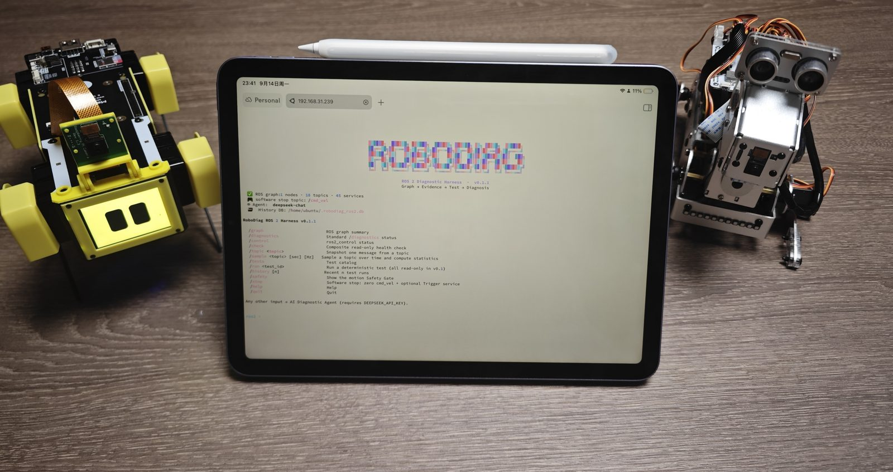
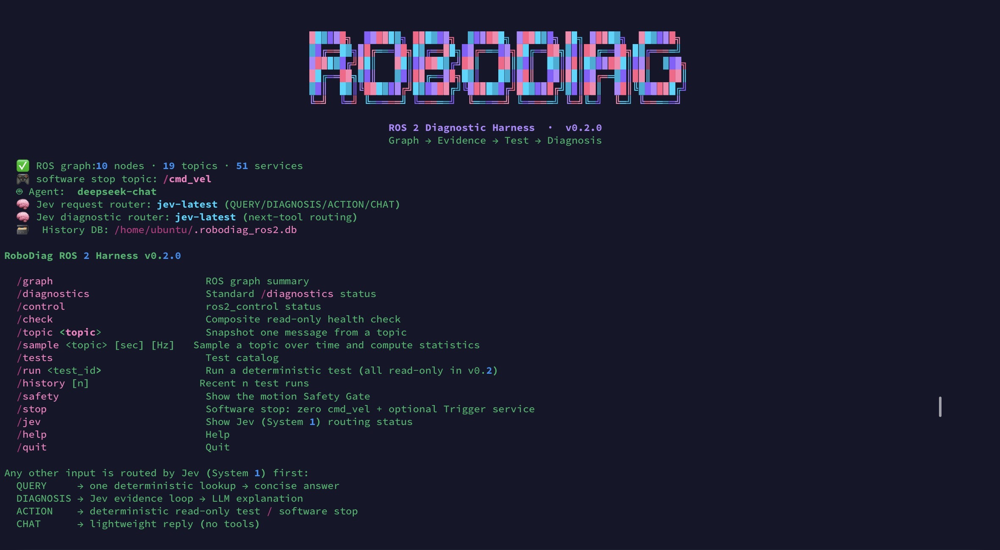

# RoboDiag Harness 🩺🤖

**A diagnostic harness for ROS 2 robots.**

[](LICENSE)


**Official website:** <https://robodiag.cn>



Your robot is connected. But is it *healthy*?

Is telemetry arriving at the rate it should? Are the joints reporting sane values? Are the controllers actually running? And when something goes wrong, what evidence should you gather before you reach for a screwdriver?

RoboDiag puts robot telemetry, deterministic health checks, diagnostic history, and AI-assisted investigation into one terminal window.

The whole idea fits on one line:

```text
Robot → Evidence → Tests → Diagnosis
```

AI can help you decide what to look at and explain what the evidence means. But the measured data and the deterministic code stay the source of truth.

## What RoboDiag does

RoboDiag can look at the live ROS 2 graph, read standard `/diagnostics`, sample any topic over time, run deterministic health tests, and remember every result in SQLite.

On top of that sits an optional diagnostic agent that uses the *same* tools to gather evidence and explain it.

You can use it to:

* check whether important robot interfaces are alive
* inspect `/diagnostics`, joint states, and controller status
* sample sensor data over time
* chase intermittent or weird behavior
* run repeatable health checks
* look back at previous test results
* give an AI assistant controlled access to diagnostic tools

No AI model? No problem. The command-line interface works fine on its own.

## Every robot is different

Different robots expose different diagnostic information.

A mobile robot may publish battery state and `/cmd_vel`. A manipulator may run `ros2_control`. A quadruped may publish joint states, IMU, and odometry — but no battery telemetry through ROS at all.

So how does RoboDiag know what to *expect* from a particular robot? It uses **RDCD** — Robot Diagnostic Capability Description — a small, machine-readable description of which diagnostic capabilities apply to a specific robot.

RDCD is written by RoboDiag, not by the robot. The robot doesn't even know it exists; it just publishes its normal interfaces. RDCD is the harness's way of saying: "for *this* robot, I expect these signals."

Here's the current Mini Pupper 2 RDCD:

```yaml
capabilities:

  diagnostics:
    topic: /diagnostics
    message_type: diagnostic_msgs/msg/DiagnosticArray

  joint_states:
    topic: /joint_states
    message_type: sensor_msgs/msg/JointState

  imu:
    topic: /imu/data
    message_type: sensor_msgs/msg/Imu

  odometry:
    topic: /odom
    message_type: nav_msgs/msg/Odometry

  velocity_command:
    topic: /cmd_vel
    message_type: geometry_msgs/msg/Twist
```

There is no `battery` entry, because Mini Pupper 2 doesn't currently expose battery telemetry to RoboDiag.

That one omission changes everything, and it's worth understanding why:

```text
Capability not declared
        ↓
Not supported for this robot
        ↓
The test is N/A

Capability declared
        ↓
Expected at runtime
        ↓
Missing data is a real finding
```

Because battery isn't declared, RoboDiag does **not** go hunting for battery telemetry, does **not** run a battery health test, and does **not** require battery evidence before allowing motion. The battery test simply shows up as `N/A`, not as a fault.

Mini Pupper 2 is the first RDCD reference robot.

## Getting started

### 1. Prepare ROS 2

Simplest setup: run RoboDiag on the same computer as the robot's ROS 2 software.

Make sure ROS 2 is installed and the robot nodes are running.

RoboDiag can also run on another machine. In that case, both machines need compatible ROS 2 environments and working DDS discovery across the network. Match `ROS_DOMAIN_ID` on both sides.

If your robot uses custom message packages, source its workspace before starting RoboDiag.

### 2. Clone the repository

```bash
git clone https://github.com/YueBit/robodiag-harness.git
cd robodiag-harness
```

### 3. Start RoboDiag

Plain generic ROS 2 mode:

```bash
bash ./robodiag
```

With a workspace overlay:

```bash
ROBODIAG_WS=~/robot_ws bash ./robodiag
```

With the Mini Pupper 2 RDCD:

```bash
bash ./robodiag --rdcd mini_pupper_2
```

Or load an RDCD straight from a YAML file:

```bash
bash ./robodiag --rdcd path/to/robot.yaml
```

No `--rdcd`? RoboDiag stays in generic mode and keeps the existing interface-discovery behavior.

## Mini Pupper 2

Mini Pupper 2 is the first robot with a RoboDiag RDCD. Its declared capabilities:

| Capability | ROS 2 interface |
|---|---|
| Diagnostics | `/diagnostics` |
| Joint states | `/joint_states` |
| IMU | `/imu/data` |
| Odometry | `/odom` |
| Velocity command | `/cmd_vel` |
| Battery telemetry | Not supported |

Start it with:

```bash
bash ./robodiag --rdcd mini_pupper_2
```

Then type `/rdcd` to inspect the active capability description.

You can switch RDCDs at runtime, no restart needed:

```text
/rdcd mini_pupper_2
/rdcd path/to/other_robot.yaml
/rdcd off
```

`/rdcd off` returns to generic mode.

RoboDiag checks each declared capability against the live ROS graph and reports one of:

```text
AVAILABLE
MISSING
TYPE_MISMATCH
```

Capabilities the RDCD doesn't declare are simply "not supported" for that robot.

## REPL commands



```text
/graph                         ROS graph summary
/diagnostics                   Standard /diagnostics status
/control                       ros2_control status
/check                         Composite read-only health check
/topic <topic>                 Snapshot one message from a topic
/sample <topic> [sec] [Hz]     Sample a topic over time
/tests                         Test catalog
/run <test_id>                 Run a deterministic health test
/history [n]                   Recent test runs
/safety                        Show the motion Safety Gate
/stop                          Request a software stop
/rdcd [robot|path|off]         Show or switch the active RDCD
/verify                        Continue the last diagnosis with more read-only checks
/jev                           Show Jev routing status
/help                          Help
/quit                          Quit
```

Anything else you type can be handled as natural language, if AI is configured.

After a diagnosis, the agent offers to keep going: `/verify` (or saying "continue verify") runs another planner-driven round of read-only checks against the same diagnosis and prints an updated report. If there's nothing left worth measuring, it says so — instead of suggesting checks the harness can't actually run.

Slash-command results feed back into the next natural-language turn. Run `/check`, then ask the agent about what it reported, without repeating yourself.

Examples:

```text
What is the battery level?

Are there any diagnostic errors?

Why are the joints behaving strangely?

Check whether the robot looks healthy.
```

## Deterministic health tests

Built-in tests:

| Test | Purpose |
|---|---|
| `graph_health` | Is the ROS graph alive, and are core robot signals present? |
| `diagnostics_health` | Inspect `/diagnostics` status and freshness |
| `battery_health` | Check BatteryState percentage, voltage, freshness, validity |
| `joint_states_health` | Sample joint states; check rate, values, stream health |
| `ros2_control_health` | Inspect controllers, hardware, interfaces |
| `system_health` | Run the applicable tests and combine the result |

Normal results:

```text
PASS
WARN
FAIL
SKIP
```

When an RDCD is active and a test's required capability isn't declared, the result is:

```text
N/A
```

Internally that's `NOT_SUPPORTED`. It never drags down overall health. Mini Pupper 2 doesn't declare battery or `ros2_control`, so those checks simply don't count against it.

But a declared capability that *should* exist and is missing at runtime is different — that's a real finding.

Every test run lands in SQLite; review it with `/history`.

## Safety model

RoboDiag keeps two things strictly apart: *diagnostic reasoning* and *action safety*.

The rule:

> AI may request evidence and tests. Deterministic code decides what is true and what is allowed.

The Safety Gate is plain code, not an LLM.

No RDCD? The existing generic safety assumptions apply. With an RDCD, only the capabilities declared for that robot count as required safety evidence.

```text
Mini Pupper 2 RDCD
    diagnostics      supported
    joint_states     supported
    battery          not supported
```

So the Safety Gate checks diagnostics and joint-state evidence, but doesn't block Mini Pupper 2 just because battery telemetry doesn't exist.

Missing evidence for a capability the active robot config *expects* still fails closed.

`/stop` sends a software stop through the configured velocity topic, and can optionally call a `std_srvs/Trigger` service.

A software stop is not a replacement for a physical e-stop.

## AI-assisted diagnosis

Two routing modes.

### Classic function calling

With an OpenAI-compatible model configured, the model can request read-only RoboDiag tools, inspect the results, and write a diagnosis. DeepSeek is the default; other OpenAI-compatible endpoints work too.

### Jev routing

Configure `TYPESAFE_API_KEY` and Jev becomes a fast decision layer with one job:

```text
User request
    ↓
QUERY / DIAGNOSIS / ACTION / CHAT
```

For a diagnosis, Jev picks which read-only evidence tool to call next.

But before a diagnosis can finalize, deterministic code insists the evidence include **at least one deterministic health test and at least one live measurement**. If Jev tries to stop early, the harness runs the missing check itself — it doesn't hand the operator a to-do list.

After the first explanation, a verification planner compares the draft against the evidence and proposes up to four read-only checks that would close the gaps. The proposal is re-validated against a deterministic allowlist, executed by the harness, and then the explainer runs again on the new evidence. This repeats a bounded number of rounds — so a diagnosis reports the *result* of a check, not a *recommendation* to run one. Checks the harness genuinely can't run stay under "Still unverified."

Responsibilities stay clean:

| Component | Responsibility |
|---|---|
| Deterministic tools | Measure robot state |
| Jev | Decide what evidence to collect next |
| LLM | Explain the collected evidence |
| Safety Gate | Decide whether an action is permitted |

Jev never executes motion or write operations.

## Diagnostic tools

| Tool | Purpose |
|---|---|
| `inspect_graph` | Inspect nodes, topics, services, types |
| `get_diagnostics` | Read cached standard diagnostics |
| `inspect_ros2_control` | Inspect controllers and hardware |
| `get_topic_snapshot` | Read one message from any discovered topic |
| `sample_topic` | Sample a topic over a time window |
| `list_tests` | List deterministic health tests |
| `run_test` | Run one health test |
| `query_history` | Read previous test results |
| `check_motion_safety` | Evaluate the deterministic Safety Gate |
| `emergency_stop` | Request the software stop path |

Tool results come back as structured data, not free-form text.

## Topic sampling

RoboDiag can dynamically load the message type of a discovered ROS 2 topic.

```text
/sample /joint_states 3 10
```

The sampler computes numeric statistics:

```text
min
max
mean
std
range
```

Handy for investigating sensor variation, intermittent behavior, and shifting telemetry.

Note: sampling here is meant for *diagnostic evidence gathering*, not high-frequency data acquisition.

## Configuration

AI configuration precedence:

```text
CLI flags
environment variables
~/.robodiag.env
built-in defaults
```

Example `~/.robodiag.env`:

```bash
DEEPSEEK_API_KEY=sk-...
DEEPSEEK_BASE_URL=https://api.deepseek.com
DEEPSEEK_MODEL=deepseek-chat

TYPESAFE_API_KEY=apikey_...
TYPESAFE_BASE_URL=https://api.typesafe.ai
TYPESAFE_MODEL=jev-latest
```

Examples:

```bash
./robodiag --model deepseek-reasoner

./robodiag \
  --base-url https://dashscope.aliyuncs.com/compatible-mode/v1 \
  --model qwen-max

./robodiag --api-key-file ~/.deepseek.key
```

`--api-key` / `--jev-api-key` can leak through shell history or process listings. Prefer environment variables, `~/.robodiag.env`, or key files.

## CLI options

| Option | Default | Purpose |
|---|---|---|
| `--rdcd` | none | Robot ID or RDCD YAML path |
| `--controller-manager` | `/controller_manager` | ros2_control manager namespace |
| `--cmd-vel-topic` | `/cmd_vel` | Fallback software-stop Twist topic |
| `--estop-service` | none | Optional Trigger stop service |
| `--db` | `~/.robodiag_ros2.db` | SQLite history path |
| `--model` | `deepseek-chat` | LLM model |
| `--base-url` | `https://api.deepseek.com` | OpenAI-compatible endpoint |
| `--api-key-file` | none | Read LLM API key from a file |
| `--jev-model` | `jev-latest` | Jev model |
| `--jev-base-url` | `https://api.typesafe.ai` | TypeSafe endpoint |
| `--jev-api-key-file` | none | Read TypeSafe key from a file |

## Health thresholds

| Variable | Default | Purpose |
|---|---|---|
| `ROBODIAG_MIN_BATTERY_PCT` | `0.10` | Minimum battery percentage when battery applies |
| `ROBODIAG_MIN_BATTERY_V` | `0.0` | Minimum battery voltage when configured |
| `ROBODIAG_MAX_DIAG_AGE_S` | `5.0` | Maximum diagnostics age |
| `ROBODIAG_MAX_BATTERY_AGE_S` | `5.0` | Maximum battery-state age |
| `ROBODIAG_MAX_JOINT_STATE_AGE_S` | `1.0` | Maximum joint-state age |
| `ROBODIAG_DB` | `~/.robodiag_ros2.db` | History database |

## How it works

```text
                    user
                     │
          ┌──────────┴──────────┐
          │                     │
    natural language        REPL commands
          │                     │
          ▼                     ▼
    request routing       direct dispatch
          │                     │
          └──────────┬──────────┘
                     ▼
          deterministic tool layer
                     │
          ┌──────────┼───────────┐
          │          │           │
       tests      history    Safety Gate
          │                      │
          └──────────┬───────────┘
                     │
                    RDCD
              when configured
                     │
                     ▼
                ROS 2 robot
```

RDCD decides which capabilities apply. The ROS graph provides the actual runtime evidence. The test layer evaluates that evidence. AI sits above the deterministic tools — it never replaces them.

## Project structure

| File | Purpose | ROS required? |
|---|---|---|
| `robodiag_ros2.py` | ROS node, CLI, REPL, topic tools, AI integration | Yes |
| `robodiag_core.py` | Test runner, history, Safety Gate, deterministic core | No |
| `robodiag_rdcd.py` | RDCD loading, validation, capability status | No |
| `robodiag_jev.py` | Jev routing and diagnostic state | No |
| `robodiag` | Launcher | Shell / ROS environment |
| `rdcd/mini_pupper_2.yaml` | First robot-specific RDCD | No |

The deterministic core, RDCD logic, and Jev routing can all be tested without a running ROS environment.

## Installation with pip

`rclpy` and the ROS message packages come from your ROS 2 installation, not PyPI.

From source:

```bash
pip install -e ".[all]"
```

For ROS 2 Humble environments using an older system `setuptools`:

```bash
pip install --user --no-build-isolation ".[all]"
```

Once published to PyPI, the intended install is:

```bash
pip install robodiag-harness
```

or:

```bash
pip install "robodiag-harness[all]"
```

### Dependencies

| Dependency | Purpose |
|---|---|
| ROS 2 Humble | Current tested ROS environment |
| Python 3.10 | Runtime |
| `rich` | Terminal UI |
| `prompt_toolkit` | Optional command completion |
| `openai` | Optional AI agent |
| `controller_manager_msgs` | Optional ros2_control inspection |

## Testing

The core test suite runs without ROS 2 or API keys.

```bash
python3 -m unittest test_core
python3 -m unittest test_rdcd
python3 test_jev.py
python3 test_request_router.py
```

`test_core.py` — deterministic test runner, history, Safety Gate.

`test_rdcd.py` — RDCD loading, applicability, runtime availability, `NOT_SUPPORTED` behavior, system-health aggregation, RDCD-aware Safety Gate.

`test_jev.py` — offline routing checks plus optional live TypeSafe tests.

`test_request_router.py` — request classification and language handling.

## Design principles

**Evidence before reasoning**

Robot state comes from measured telemetry, not from an AI model's assumptions.

**Robot-specific applicability**

A missing capability and an unsupported capability are not the same thing. RDCD defines what RoboDiag should expect from a particular robot.

**Deterministic diagnostics**

Health tests return structured results based on measured evidence.

**Deterministic safety**

AI can request information, but it never decides whether motion or a write operation is safe.

**Generic robot access where possible**

RoboDiag can inspect arbitrary ROS topics without an RDCD. RDCD adds robot-specific diagnostic knowledge on top.

## Current limitations

RoboDiag is an experimental diagnostic harness, not a certified robot safety system.

The first RDCD targets Mini Pupper 2. Supporting more robot families means more RoboDiag-authored capability descriptions, and where needed, support for their interfaces.

The current software stop depends on the robot's ROS implementation and communication path.

Health checks can only evaluate what the robot makes observable.

AI-generated explanations may be wrong. Always review the underlying evidence.

## Future direction

RDCD exists to separate robot-specific diagnostic knowledge from the generic RoboDiag runtime.

The long-term model:

```text
Mini Pupper 2 + Mini Pupper RDCD
                │
                ▼
          RoboDiag Harness

Future robot + its RDCD
                │
                ▼
        same RoboDiag Harness
```

The RDCD schema is still experimental. Mini Pupper 2 is the first implementation, and it will teach us what belongs in the description before we generalize the format.

## Contributing

Bug reports, documentation improvements, diagnostic tests, and robot integrations are all welcome.

When reporting an issue, include: robot model, ROS 2 distribution, the command you ran, expected behavior, and relevant logs.

Strip credentials or private info from logs before posting.

## License

Apache License 2.0. See [LICENSE](LICENSE).

ROS and ROS 2 are trademarks of Open Robotics. This project is not affiliated with or endorsed by Open Robotics or Intrinsic.
